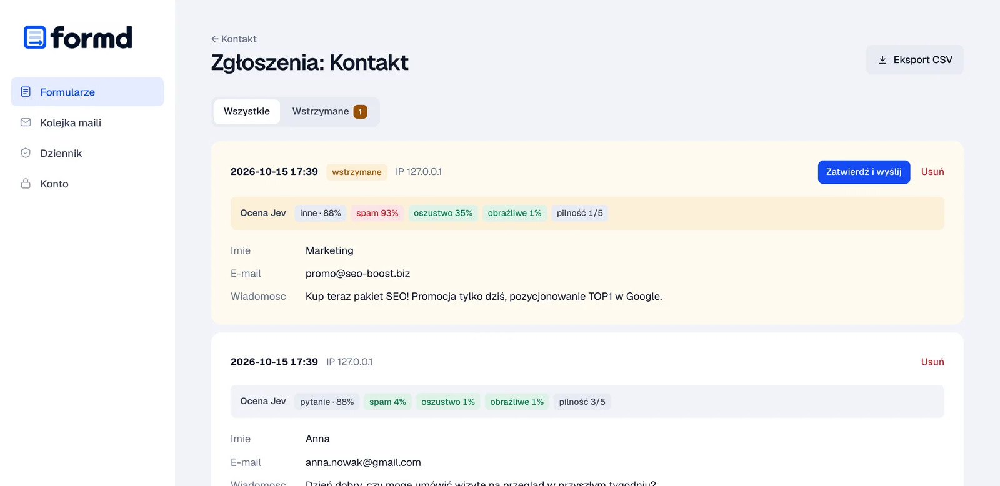

# formd

[](https://github.com/dc9-dev/formd/actions/workflows/ci.yml) [](https://github.com/dc9-dev/formd/releases/latest) [](LICENSE)

[English](README.md) · **Polski**

**Samodzielny backend formularzy dla stron statycznych.** Jedna binarka w Go, którą instalujesz na tym samym serwerze co stronę. Przyjmuje formularz, waliduje go, zapisuje do SQLite i wysyła powiadomienie do właściciela oraz potwierdzenie do nadawcy (SMTP, Amazon SES albo tylko log). Bez zewnętrznych SaaS-ów, bez captchy od firm trzecich, bez wysyłania danych poza serwer.

Strona projektu: **https://formd.top/**. Jest tam demo na żywo: możesz wysłać formularz albo bota i zobaczyć, która kontrola go zatrzyma. Jest też instrukcja instalacji krok po kroku, dopasowana do Twojej domeny.

```
przeglądarka ──POST /f/kontakt──▶ nginx/Caddy (TLS) ──▶ 127.0.0.1:8025  formd (API)
                                                         127.0.0.1:8026  formd (panel, przez tunel SSH)
                                                               │
                                                        SQLite + kolejka maili ──▶ SMTP / SES
```

## Co robi

- **API formularzy** `POST /f/{id}`: urlencoded, multipart (bez plików) i JSON. Bez JS działa przekierowanie 303, a przy `fetch` odpowiedź w JSON.
- **Panel admina**: tworzenie i konfiguracja formularzy (pola, originy, odbiorcy, szablony maili, limity), przegląd i eksport zgłoszeń (CSV), kolejka maili z ponawianiem, dziennik zdarzeń.
- **Kolejka maili (outbox)**: zgłoszenie i maile zapisują się w jednej transakcji, więc awaria SMTP nie gubi wiadomości. Nieudane wysyłki są ponawiane z backoffem (1 min → 24 h).
- **Retencja**: zgłoszenia starsze niż N dni są automatycznie usuwane (RODO).



## Bezpieczeństwo

| Warstwa | Mechanizm |
| --- | --- |
| Sieć | Nasłuch tylko na konkretnym IP (`0.0.0.0` jest odrzucane przy starcie). Allowlista IP połączeń sprawdzana przed routingiem. Nagłówki `X-Forwarded-For` / `X-Real-IP` honorowane wyłącznie od zaufanych proxy. |
| Panel | Osobny port, nigdy nie proxowany. Allowlista IP + allowlista nagłówka `Host` (ochrona przed DNS rebinding). Hasła w argon2id. Sesje po stronie serwera, w bazie tylko hash tokenu. Cookie `HttpOnly` + `SameSite=Strict` + `Secure`. Token CSRF per sesja + sprawdzanie `Origin`/`Sec-Fetch-Site`. Ścisły CSP, bez JavaScriptu. Limit prób logowania per IP i per login. Dziennik audytowy. |
| Dane wejściowe | Pola spoza definicji są odrzucane. Długość liczona w znakach. Zakaz znaków sterujących, bidi i nowych linii w polach jednowierszowych. Adres e-mail bez nazwy wyświetlanej. Limit rozmiaru body. Brak uploadu plików. |
| Maile | Nagłówki budowane z walidowanych adresów, CR/LF w nagłówku kończy się błędem (brak header injection). Temat czyszczony do jednej linii. Szablony HTML escapowane automatycznie (`html/template`). STARTTLS wymagany, bez cichego downgrade'u. |
| Eksport | CSV neutralizuje formula injection (`=`, `+`, `-`, `@`). |
| Proces | Jednostka systemd z pełnym utwardzeniem (`ProtectSystem=strict`, filtr syscalli, brak capabilities). Baza i katalog z prawami 0600/0700. |

### Ochrona przed masową wysyłką

Każdy formularz ma własne ustawienia w panelu:

1. **Podpisany challenge + proof-of-work.** `formd.js` pobiera token podpisany HMAC i przed wysłaniem rozwiązuje zadanie SHA-256 o zadanej trudności (domyślnie 16 bitów, ułamek sekundy dla człowieka, kosztowne przy tysiącach zgłoszeń). Token jest jednorazowy, powiązany z formularzem i ważny 2 h. Nie trzeba zewnętrznej captchy.
2. **Minimalny czas wypełnienia** liczony po stronie serwera od wydania tokenu.
3. **Limity tempa:** per IP i formularz, per IP globalnie, dla wydawania challenge'y, godzinowy limit przyjęć na formularz oraz globalny limit maili na godzinę.
4. **Potwierdzenia:** limit maili na jeden adres na dobę, żeby nikt nie zrobił z Twojego serwera narzędzia do mail-bombingu.
5. **Filtry treści:** honeypot, maksymalna liczba linków, lista zablokowanych fraz, odrzucanie duplikatów.
6. **Ciche odrzucanie:** spam i duplikaty dostają udawany sukces, więc bot nie wie, który filtr go złapał.
7. **Logi pod fail2ban:** gotowy filtr w `deploy/fail2ban-filter.conf`.
8. **Ocena treści przez Jev** (opcjonalna) — opis niżej.

## Ocena treści (Jev)

Opcjonalnie formd może oceniać treść wiadomości modelem [Jev](https://typesafe.ai/blog/introducing-system-one-models-and-jev) (TypeSafe) przez OpenRouter albo polskim modelem na własnym sprzęcie ([niżej](#polski-model-na-własnym-sprzęcie-basal)). Jev nie generuje tekstu — zwraca skalibrowane prawdopodobieństwa dla z góry zdefiniowanych pytań. Dla każdego zgłoszenia formd pyta o:

| Pytanie | Typ | Wynik |
| --- | --- | --- |
| Cel wiadomości | `choice` | pytanie / zamówienie-oferta / reklamacja / opinia / inne |
| Spam (reklama, SEO, mass mailing, treść niezwiązana ze stroną) | `noul` | prawdopodobieństwo 0–100% |
| Oszustwo / phishing | `noul` | prawdopodobieństwo 0–100% |
| Treść obraźliwa | `noul` | prawdopodobieństwo 0–100% |
| Pilność | `score` | 1–5 |

**Ryzyko** = max(spam, oszustwo, obraźliwe). Gdy przekroczy próg ustawiony w panelu (domyślnie 70%), formd robi to, co wybierzesz dla formularza:

- **Wstrzymaj** (domyślnie) — zgłoszenie jest zapisane, ale maile (także potwierdzenie do nadawcy) czekają, aż zatwierdzisz je w panelu w zakładce *Wstrzymane*.
- **Oznacz** — maile wychodzą normalnie, z prefiksem `[SPAM?]` w temacie.
- **Odrzuć** — zgłoszenie jest cicho porzucane, jak inny spam.

Ocena każdego zgłoszenia jest widoczna w panelu i dopisana do maila z powiadomieniem.

**Bezpieczeństwo i koszty:**

- Jev jest pytany **dopiero po wszystkich tanich filtrach** (challenge, limity, honeypot, duplikaty), więc boty odrzucone wcześniej nic nie kosztują.
- Pytania są stałe, po angielsku, zaszyte w kodzie. Treść od użytkownika trafia wyłącznie do `state`, w osłoniętych blokach, z adnotacją, że to niezaufane dane. Mimo to tekst może próbować sterować oceną — dlatego domyślną akcją jest *wstrzymaj*, a nie nieodwracalne *odrzuć*.
- **Prywatność:** treść pól jest wysyłana do OpenRouter i TypeSafe. Adresy e-mail są zastępowane samą domeną. Funkcja jest wyłączona, dopóki nie ustawisz klucza i nie włączysz jej w konkretnym formularzu — uwzględnij to w polityce prywatności strony.
- Dzienny budżet (`JEV_DAILY_BUDGET_USD`), timeout (`JEV_TIMEOUT`, domyślnie 4 s) i licznik kosztów na stronie głównej panelu. Jedno zgłoszenie kosztuje ok. 0,00002 USD.
- Gdy Jev nie odpowie albo budżet się wyczerpie, zgłoszenie przechodzi bez oceny (fail-open); w ustawieniach formularza można zamiast tego je wstrzymywać.
- Klucz API jest wysyłany tylko po HTTPS i nigdy nie trafia do logów ani komunikatów błędów.

Konfiguracja w `.env`:

```sh
OPENROUTER_API_KEY=sk-or-...      # https://openrouter.ai/settings/keys (ustaw limit kredytów)
JEV_MODEL=jev-1.13
JEV_TIMEOUT=4s
JEV_DAILY_BUDGET_USD=1
```

Potem w panelu: formularz → **Ocena treści (Jev)** → włącz, wybierz akcję i próg, dopisz jednym zdaniem, czego dotyczy strona (to poprawia trafność).

### Polski model na własnym sprzęcie (basal)

Zamiast Jev przez OpenRouter formd może używać otwartych modeli **basal** od [Remka](https://huggingface.co/Remek), trenowanych do decyzji po polsku i angielsku. Działają na Twojej maszynie w silniku [basal](https://github.com/rkinas/basal) (Apache-2.0), który ma to samo API System One co Jev, więc formd zadaje im te same pytania. Treść pól nie opuszcza Twojej infrastruktury i nie ma kosztu za zapytanie.

| Model | Na bazie | Gdzie działa |
| --- | --- | --- |
| [`Remek/basal-omni-1.0-ultra`](https://huggingface.co/Remek/basal-omni-1.0-ultra) (31B, domyślny w formd) | Gemma 4 | GPU NVIDIA; wagi BF16 potrzebują ok. 62 GB pamięci GPU (karta 80 GB) |
| [`Remek/basal-2.0-4.5B`](https://huggingface.co/Remek/basal-2.0-4.5B) | Bielik v3 (polski) | mniejsze GPU NVIDIA, Mac z Apple Silicon (`-MLX-8bit`) albo CPU przez Ollamę (`-GGUF`) |

**1. Zainstaluj silnik.** Na maszynie z NVIDIA, w świeżym środowisku Pythona (według instrukcji basal; aktualną wersję oraz warianty dla Maca, Ollamy i llama.cpp znajdziesz w [docs/INSTALL.md](https://github.com/rkinas/basal/blob/main/docs/INSTALL.md)):

```sh
uv venv --python 3.12 ~/basal-env && source ~/basal-env/bin/activate
uv pip install torch==2.11.0 --index-url https://download.pytorch.org/whl/cu128
uv pip install "basal[fp8] @ https://github.com/rkinas/basal/archive/refs/tags/v2.2.0.tar.gz"
```

**2. Uruchom go tylko na localhost** (basal-serve nie ma uwierzytelniania):

```sh
# model 31B
basal-serve --model Remek/basal-omni-1.0-ultra --mode eager --host 127.0.0.1 --port 8000

# albo mniejszy model na bazie Bielika
basal-serve --model Remek/basal-2.0-4.5B --mode fast --template-prefix off --host 127.0.0.1 --port 8000
```

Przy pierwszym starcie wagi pobierają się z Hugging Face. Uruchom go jako usługę (np. jednostkę systemd), żeby wstawał po restarcie.

**3. Sprawdź, czy odpowiada:**

```sh
curl -s http://127.0.0.1:8000/v1/systemone -H 'content-type: application/json' -d '{
  "state": "Najtańsze linki SEO, kup teraz!",
  "questions": {"spam": {"type": "noul", "instructions": "Czy ta wiadomość to spam?"}}}'
# {"model": "...", "answers": {"spam": {"type": "noul", "noul": 0.9..., ...}}, ...}
```

**4. Wskaż go formd** w `/etc/formd/formd.env` i zrestartuj formd:

```sh
JEV_PROVIDER=basal
# domyślnie: JEV_URL=http://127.0.0.1:8000/v1/systemone, JEV_MODEL=Remek/basal-omni-1.0-ultra
# przy innym modelu podaj tę samą nazwę co w --model:
#JEV_MODEL=Remek/basal-2.0-4.5B
# na CPU daj więcej czasu (najwyżej 15s; o tyle wydłuża się wysłanie formularza):
#JEV_TIMEOUT=10s
```

W logu startu pojawi się `jev content assessment available provider=basal`. Potem w panelu włącz **Ocena treści (Jev)** dla formularza. Ustawienia formularza pokażą, który model ocenia zgłoszenia i że treść zostaje na serwerze.

**Uwagi:**

- formd przyjmuje zwykły `http` wyłącznie dla adresu lokalnego. Jeśli model działa na innej maszynie, postaw przed nim bramkę HTTPS i ustaw `JEV_URL=https://…`. Jeśli bramka wymaga tokenu, ustaw `BASAL_API_KEY` (wysyłany jako `Authorization: Bearer`). `OPENROUTER_API_KEY` nigdy nie trafia do serwera basal.
- Licznik kosztów i dzienny budżet nie mają zastosowania; panel ukrywa kafelek z kosztem. Wstrzymywanie, oznaczanie, progi i fail-open działają tak samo jak z Jev.
- Integracja formd jest przetestowana na formacie API opisanym w dokumentacji basal, a nie na prawdziwym wdrożeniu z GPU. Jeśli coś się nie zgodzi, zgłoszenie przejdzie bez oceny, a panel pokaże błąd.

## Szybki start

```sh
make build                       # lub: go install github.com/dc9-dev/formd/cmd/formd@latest
cp .env.example .env             # ustaw MAILER=log na początek
./formd user add admin           # konto do panelu (min. 12 znaków hasła)
./formd serve
```

Panel: `http://localhost:8026`. Utwórz formularz, podaj origin strony, pola i odbiorców, a potem włącz go. Gotowy kod HTML znajdziesz w zakładce **Kod HTML**, a przykład w [`examples/contact.html`](examples/contact.html).

```html
<form action="/f/kontakt" method="post" data-formd="ajax">
  <input name="name" required>
  <input type="email" name="email" required>
  <textarea name="message" required></textarea>
  <div style="position:absolute;left:-10000px" aria-hidden="true"><input name="website" tabindex="-1" autocomplete="off"></div>
  <button>Wyślij</button>
  <p data-formd-status role="status"></p>
</form>
<script src="/f/formd.js" defer></script>
```

> Względny adres `/f/kontakt` działa, gdy formd jest wystawiony przez reverse proxy **na tej samej domenie co strona**. Przy osobnej subdomenie użyj pełnych adresów `https://…` — patrz [HTTPS i reverse proxy](#https-i-reverse-proxy).

## Wdrożenie na serwerze

```sh
make dist                                     # dist/formd-linux-amd64, -arm64
scp dist/formd-linux-amd64 serwer:/tmp/formd
sudo ./deploy/install.sh /tmp/formd           # użytkownik formd, /etc/formd, systemd
sudo systemctl enable --now formd
sudo -u formd formd -env /etc/formd/formd.env user add admin
```

- Panel z własnego komputera: `ssh -L 8026:127.0.0.1:8026 serwer`, potem `http://localhost:8026`.
- Formularze wystawiasz przez reverse proxy z HTTPS — opis niżej.

## HTTPS i reverse proxy

formd **nie obsługuje TLS i nie powinien być osiągalny z internetu** — słucha tylko na `127.0.0.1`. Szyfrowanie zapewnia reverse proxy (nginx lub Caddy), które przyjmuje połączenie HTTPS od przeglądarki i przekazuje do formd wyłącznie ścieżkę `/f/`.

To nie jest opcja, tylko wymóg: strona serwowana po HTTPS **nie może** wysłać formularza na adres `http://`. Przeglądarka zablokuje `fetch` jako *mixed content*, a zwykły POST formularza pokaże ostrzeżenie o niezabezpieczonym formularzu lub go zablokuje. Adres w `action` musi więc być adresem HTTPS obsługiwanym przez Twoje proxy.

```
przeglądarka ──HTTPS──▶ nginx / Caddy :443 (certyfikat) ──HTTP──▶ 127.0.0.1:8025 formd
                        └─ tylko /f/*                            (ruch lokalny, poza siecią)
```

### Który wariant?

| | A. Ta sama domena (zalecany) | B. Osobna subdomena |
| --- | --- | --- |
| Kiedy | Strona statyczna leży na tym samym serwerze co formd | Strona jest gdzie indziej: GitHub Pages, Netlify, S3/CloudFront, inny serwer |
| `action` formularza | `/f/kontakt` | `https://forms.example.com/f/kontakt` |
| Skrypt | `/f/formd.js` | `https://forms.example.com/f/formd.js` |
| Certyfikat | ten sam co strona | osobny dla `forms.example.com` |
| CORS | nie występuje | formd odpowiada nagłówkami CORS dla originów z panelu |
| Konfiguracja | [`deploy/nginx-same-domain.conf`](deploy/nginx-same-domain.conf), [`deploy/Caddyfile`](deploy/Caddyfile) | [`deploy/nginx-subdomain.conf`](deploy/nginx-subdomain.conf), [`deploy/Caddyfile`](deploy/Caddyfile) |

W obu wariantach **dozwolony origin w panelu to adres strony** (np. `https://example.com`), a nie adres formd.

### Krok po kroku (nginx + Let's Encrypt)

```sh
# 1. (wariant B) rekord DNS: forms.example.com -> IP serwera
# 2. konfiguracja
sudo cp deploy/nginx-same-domain.conf /etc/nginx/conf.d/example.com.conf   # albo nginx-subdomain.conf
sudo nano /etc/nginx/conf.d/example.com.conf                               # podmień example.com
# 3. certyfikat (certbot sam wpisze ścieżki i będzie odnawiał)
sudo certbot --nginx -d example.com -d www.example.com                      # B: -d forms.example.com
sudo nginx -t && sudo systemctl reload nginx
```

Caddy robi krok 3 automatycznie: wystarczy [`deploy/Caddyfile`](deploy/Caddyfile) z Twoją domeną i `systemctl reload caddy`.

Ustawienia w `/etc/formd/formd.env` pasujące do proxy na tym samym hoście:

```sh
LISTEN_ADDR=127.0.0.1:8025
ALLOWED_IPS=127.0.0.1,::1        # tylko proxy może łączyć się z formd
TRUSTED_PROXIES=127.0.0.1,::1    # tylko od proxy wierzymy X-Real-IP (limity per IP)
```

Jeśli proxy stoi na **innej maszynie** niż formd, ustaw `LISTEN_ADDR` na prywatny adres tej maszyny (np. `10.0.0.5:8025`), a w `ALLOWED_IPS` i `TRUSTED_PROXIES` wpisz adres proxy. Ruch między nimi powinien iść siecią prywatną lub VPN (WireGuard), nigdy przez internet.

### Komunikaty w innych językach

Domyślne komunikaty `formd.js` są po polsku. Na stronach w innych językach ustaw je atrybutami formularza:

```html
<form action="/f/kontakt" method="post" data-formd="ajax"
      data-formd-sending="Sending…"
      data-formd-success="Thank you! Your message has been sent."
      data-formd-error="Your message could not be sent. Please email us."
      data-formd-network-error="Could not send the form. Please try again."
      data-formd-server-errors="off">
```

`data-formd-server-errors="off"` ukrywa szczegółowe komunikaty walidacji z serwera (są po polsku) i pokazuje zamiast nich `data-formd-error`.

### Wariant B: strona na innym hostingu

```html
<form action="https://forms.example.com/f/kontakt" method="post" data-formd="ajax">
  …
</form>
<script src="https://forms.example.com/f/formd.js" defer></script>
```

Jeśli strona ma własny Content-Security-Policy, dopisz `https://forms.example.com` do `script-src`, `connect-src` i `form-action`.

### Sprawdzenie

```sh
curl -I https://example.com/f/formd.js                # 200, text/javascript
curl -s https://example.com/f/kontakt/challenge \
     -H 'Origin: https://example.com'                  # {"token":"…","bits":16,…}
curl -s -o /dev/null -w '%{http_code}\n' \
     https://example.com/f/kontakt/challenge \
     -H 'Origin: https://evil.example'                 # 403 — obcy origin
curl -s -o /dev/null -w '%{http_code}\n' http://example.com/f/formd.js   # 301 -> HTTPS
curl -s -o /dev/null -w '%{http_code}\n' --max-time 5 http://IP_SERWERA:8025/healthz   # brak połączenia — formd niewidoczny z zewnątrz
curl -s -o /dev/null -w '%{http_code}\n' --max-time 5 http://IP_SERWERA:8026/login     # brak połączenia — panel niewidoczny z zewnątrz
```

W przeglądarce: DevTools → Network → wysłanie formularza powinno pokazać `POST https://…/f/kontakt` ze statusem 200 (wariant ajax) albo 303 (zwykły POST), bez ostrzeżeń *mixed content* w konsoli.

## Konfiguracja wysyłki

| `MAILER` | Wymaga |
| --- | --- |
| `smtp` | `SMTP_HOST`, `SMTP_PORT`, `SMTP_USER`, `SMTP_PASS`, `SMTP_TLS=starttls\|tls\|none`. Działa z SES SMTP, Postfixem, Mailgunem itd. |
| `ses` | `AWS_REGION` + standardowe poświadczenia AWS (zmienne środowiskowe lub rola IAM instancji). Wysyłka przez SES API v2. |
| `log` | Nic. Maile trafiają tylko do logów (do testów). |

Test: `formd test-mail -to ty@example.com`.

## CLI

```
formd serve
formd migrate
formd user add|passwd|del <login> · formd user list
formd list   -form kontakt -since 7d
formd export -form kontakt -format csv|json [-since 30d]
formd test-mail -to adres@example.com
```

## Rozwój

```sh
make test     # go test -race ./...
make vet
```

Struktura: `cmd/formd` (CLI), `internal/server` (publiczne API + `formd.js`), `internal/admin` (panel), `internal/antispam` (challenge, PoW, limity), `internal/forms` (definicje i walidacja), `internal/store` (SQLite), `internal/mail` (SMTP/SES/log), `internal/worker` (kolejka).

## Licencja

Copyright (C) 2026 Łukasz Sobiecki

formd jest wolnym oprogramowaniem na licencji [GNU Affero General Public License v3.0](LICENSE). Możesz go używać, zmieniać i rozpowszechniać na jej warunkach. Jeśli udostępniasz zmodyfikowaną wersję innym przez sieć, musisz udostępnić im też jej kod źródłowy.

Jeśli warunki AGPL Ci nie odpowiadają, na przykład chcesz wbudować formd w zamknięty produkt, zapytaj o licencję komercyjną w [zgłoszeniu na GitHubie](https://github.com/dc9-dev/formd/issues).
